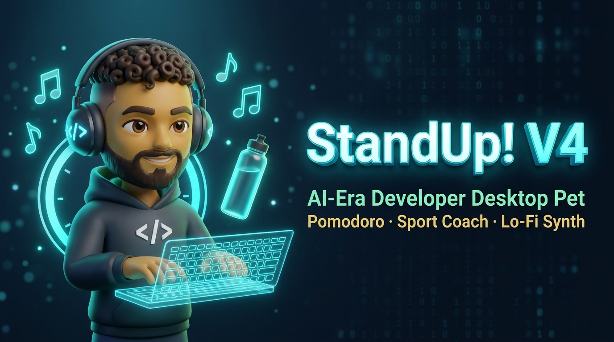
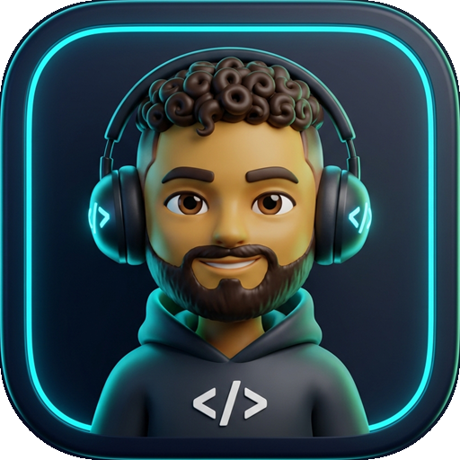
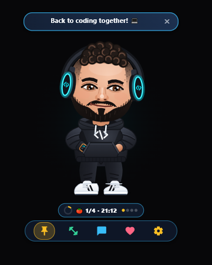
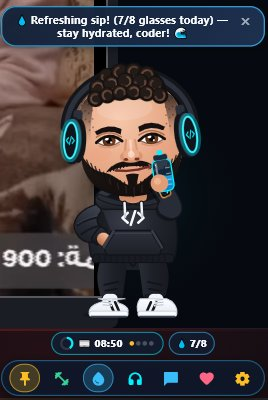
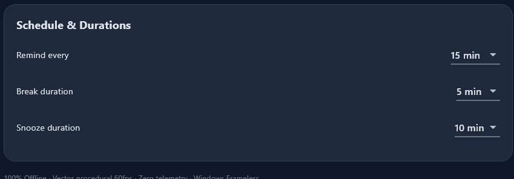
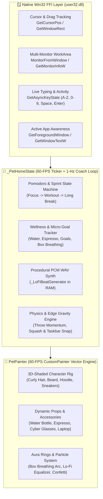

<div align="center">



<br />



# 🚀 StandUp! V4 — Developer Companion & Wellness Desktop Pet

**A 100% Offline, 60-FPS Procedural 3D-Vector Desktop Companion for Windows Engineers**  
*Pomodoro Deep-Work HUD · Win32 Keyboard & Active-App Awareness · Guided Sport & Box Breathing · Built-In Procedural Lo-Fi Synthesizer*

[](LICENSE)
[-0078D6?style=for-the-badge&logo=windows&logoColor=white)](https://github.com/Maher-Tec/standup)
[](lib/main.dart)
[](lib/main.dart)
[](lib/main.dart)

<p align="center">
  <a href="#-live-preview--screenshots"><b>📸 Screenshots</b></a> •
  <a href="#-complete-feature-matrix"><b>✨ Feature Matrix</b></a> •
  <a href="#-interactive-controls--shortcuts"><b>🎮 Controls & HUD</b></a> •
  <a href="#-system-architecture"><b>🏗️ Architecture</b></a> •
  <a href="#-build--run-from-source"><b>⚡ Build & Release .EXE</b></a> •
  <a href="#-license"><b>📜 MIT License</b></a>
</p>

</div>

---

## 🌟 Why StandUp! V4?

Long coding sessions take a toll on your posture, eyes, hydration, and focus. **StandUp! V4** puts a living, breathing, **60-FPS procedurally rendered 3D-shaded developer mini-me** directly on your Windows desktop or taskbar edge.

Unlike heavyweight Electron widgets or cloud-tethered apps, **StandUp! V4** is engineered in pure **Flutter + Direct Win32 (`user32.dll`) FFI**:
- **Zero external image sprites**: Every curl of hair, `</>` headphone earcup, hoodie drawstring, sneaker stripe, holographic laptop, water bottle, and glowing breathing ring is drawn mathematically at **60 FPS** in [`PetPainter`](lib/main.dart).
- **Zero audio MP3 bloat for Lo-Fi**: The built-in [`_LoFiBeatGenerator`](lib/main.dart) synthesizes warm Rhodes jazz chords, vinyl crackle, and chill boom-bap drums **100% procedurally in RAM** (PCM 16-bit WAV).
- **Zero telemetry**: Active window context and typing detection run 100% locally via Win32 API calls and never leave your machine.

---

## 📸 Live Preview & Screenshots

<table width="100%">
  <thead>
    <tr>
      <th width="33%" bgcolor="#0F172A">🍅 Pomodoro Mini-HUD & Chibi Buddy</th>
      <th width="33%" bgcolor="#0F172A">💧 3D Hydration & Anatomical Grip</th>
      <th width="34%" bgcolor="#0F172A">⚙️ Custom Schedule & Dashboard</th>
    </tr>
  </thead>
  <tbody>
    <tr>
      <td align="center" bgcolor="#0B132B">
        <br />
        <sub><b>Frameless Always-On-Top Window</b><br />Live Sprint Ring, Progress Dots & Frosted Action Dock</sub>
      </td>
      <td align="center" bgcolor="#0B132B">
        <br />
        <sub><b>3D Tilted Water Bottle & Sipping Stream</b><br />Daily Hydration Badge (<code>💧 7/8</code>) & Espresso Boost</sub>
      </td>
      <td align="center" bgcolor="#0B132B">
        <br />
        <sub><b>Full Glassmorphic Control Center</b><br />Custom Intervals (5m–120m), Break & Snooze Durations</sub>
      </td>
    </tr>
  </tbody>
</table>

---

## 🎨 Complete Feature Matrix

<table>
  <thead>
    <tr>
      <th align="left">🎨 Category</th>
      <th align="left">🚀 Feature</th>
      <th align="center">⚡ Status</th>
      <th align="left">🔬 Technical Highlights</th>
    </tr>
  </thead>
  <tbody>
    <tr>
      <td></td>
      <td><b>🍅 Pomodoro & Deep-Work Mini-HUD</b></td>
      <td align="center"></td>
      <td>Floating pill below sneakers with live circular progress ring, <code>1/4</code> sprint dots, auto-transition from Focus Sprint → 5m Sport Workout → 15m Long Break.</td>
    </tr>
    <tr>
      <td></td>
      <td><b>🎯 Sticky Sprint Goal Banner</b></td>
      <td align="center"></td>
      <td>Pin a 1-line focus task (e.g., <code>🎯 Fix Auth API</code>) right above the Mini-HUD. Click <code>✅ Done</code> to trigger a confetti celebration and increment daily goals.</td>
    </tr>
    <tr>
      <td></td>
      <td><b>⌨️ Live Keyboard & AFK Detection</b></td>
      <td align="center"></td>
      <td>Polls <code>GetAsyncKeyState</code> & cursor delta at 60 FPS. Pulls out a glowing 3D holographic laptop & types along with you; naps (<code>zzz</code>) when AFK for 90s and greets you on return!</td>
    </tr>
    <tr>
      <td></td>
      <td><b>🖥️ Active Window Context Awareness</b></td>
      <td align="center"></td>
      <td>Reads foreground window titles locally via <code>GetForegroundWindow</code> + <code>GetWindowTextW</code>. Cheers you on in VS Code/Android Studio/Cursor and playfully nudges you if distracted during a sprint.</td>
    </tr>
    <tr>
      <td></td>
      <td><b>💧 Hydration Bottle & ☕ Espresso</b></td>
      <td align="center"></td>
      <td>Articulated 3D arm with thumb + 4-finger grip tilts a translucent cyan sports bottle to the mouth with animated water stream & sipping lips, or steams a hot Italian espresso cup.</td>
    </tr>
    <tr>
      <td></td>
      <td><b>🎵 Lo-Fi Vibe Mode & 3D Equalizer</b></td>
      <td align="center"></td>
      <td>100% procedural in-memory PCM WAV synthesizer (warm Rhodes chords, sub-bass, vinyl dust & lo-fi drums) + rhythmic head-bobbing, earcup equalizer bars & floating <code>♪ ♫</code> notes.</td>
    </tr>
    <tr>
      <td></td>
      <td><b>🕶️ Cyber Glasses & Night-Owl Mode</b></td>
      <td align="center"></td>
      <td>Equips 3D blue-light anti-glare coding glasses automatically while typing or after 9 PM, shifts aura to circadian indigo, and gives gentle 20-20-20 eye-rest nudges.</td>
    </tr>
    <tr>
      <td></td>
      <td><b>🧘 30s Box Breathing & Posture Reset</b></td>
      <td align="center"></td>
      <td>60-FPS expanding/holding/contracting 3D glowing aura ring & 360° phase progress arc guiding you through <b>4s Inhale → 4s Hold & Sit Tall → 4s Exhale</b>.</td>
    </tr>
    <tr>
      <td></td>
      <td><b>🏋️ Interactive Sport Exercise Circuit</b></td>
      <td align="center"></td>
      <td>Full-body animated <b>Squats</b>, <b>Jumping Jacks</b>, <b>Dumbbell Curls</b> (with 3D hex weights), and <b>Side Stretches</b> with live rep counter and coaching bubbles.</td>
    </tr>
    <tr>
      <td></td>
      <td><b>🧲 Multi-Monitor Physics & Edge Snap</b></td>
      <td align="center"></td>
      <td>Zero-lag Win32 cursor dragging, elastic throw & wall bounce, squash-and-stretch landing shockwaves, and magnetic snapping to the Windows Taskbar or screen edges.</td>
    </tr>
  </tbody>
</table>

---

## 🎮 Interactive Controls & Shortcuts

### 1️⃣ Direct Character & Mini-HUD Interactions

<table>
  <thead>
    <tr>
      <th align="left">🖱️ Gesture / Target</th>
      <th align="left">🎯 Action Triggered</th>
      <th align="left">✨ Visual & Audio Feedback</th>
    </tr>
  </thead>
  <tbody>
    <tr>
      <td><b>Left-Click + Drag Character</b></td>
      <td>Move & Throw across any Monitor</td>
      <td>60-FPS velocity tilt, dangling legs, momentum glide, and magnetic taskbar/edge snap.</td>
    </tr>
    <tr>
      <td><b>Single-Click Character</b></td>
      <td>Affection / Pet Buddy</td>
      <td>Happy squinting eyes, floating pink heart particles, and cheerful encouragement.</td>
    </tr>
    <tr>
      <td><b>Double-Click Character</b></td>
      <td>Celebration Dance Party</td>
      <td>High-jump bounce animation, confetti burst, and celebration chime.</td>
    </tr>
    <tr>
      <td><b>Right-Click Character</b></td>
      <td>Open Full Glassmorphic Dashboard</td>
      <td>Expands window to <code>900×650</code> settings, stats & schedule center.</td>
    </tr>
    <tr>
      <td><b>Click <code>🎯 + Set Sprint Goal</code></b></td>
      <td>Pin or Complete Micro-Goal</td>
      <td>Choose quick presets (<code>🐛 Fix Bug</code>, <code>✨ Ship UI</code>, <code>⚡ Build API</code>) or mark <code>✅ Done</code>.</td>
    </tr>
    <tr>
      <td><b>Click <code>🍅 1/4 · 15:00</code> Pill</b></td>
      <td>Restart Focus Sprint / Finish Break</td>
      <td>Resets countdown to your configured interval (5–120 min) or completes active workout.</td>
    </tr>
    <tr>
      <td><b>Click <code>💧 4/8</code> Pill</b></td>
      <td>Log Water Glass & Sip Animation</td>
      <td>Character raises 3D cyan sports bottle, tilts it to mouth, and sips water stream.</td>
    </tr>
  </tbody>
</table>

### 2️⃣ Bottom Frosted-Glass Action Dock (Left & Right Clicks!)

<table>
  <thead>
    <tr>
      <th align="center">🔘 Dock Icon</th>
      <th align="left">🏷️ Name</th>
      <th align="left">🖱️ Left-Click Action</th>
      <th align="left">🖱️ Right-Click (Secondary) Action</th>
    </tr>
  </thead>
  <tbody>
    <tr>
      <td align="center"></td>
      <td><b>Pin / Wander</b></td>
      <td>Toggle autonomous desktop walking vs. pinned in place</td>
      <td>—</td>
    </tr>
    <tr>
      <td align="center"></td>
      <td><b>Sport & Breathe</b></td>
      <td>Start / Cycle Sport Exercises (Squats → Jacks → Dumbbells → Stretch)</td>
      <td><b>🧘 Start 30s Guided Box Breathing & Posture Reset</b></td>
    </tr>
    <tr>
      <td align="center"></td>
      <td><b>Hydration & Coffee</b></td>
      <td>Drink a glass of Water (<code>💧 +1</code>) with 3D bottle animation</td>
      <td><b>☕ Drink Hot Espresso Shot</b> with rising steam animation</td>
    </tr>
    <tr>
      <td align="center"></td>
      <td><b>Lo-Fi Vibe Mode</b></td>
      <td>Toggle offline procedural Lo-Fi synth beats, head-bob & 3D equalizer</td>
      <td>—</td>
    </tr>
    <tr>
      <td align="center"></td>
      <td><b>Coach & Glasses</b></td>
      <td>Open interactive Coach Check-In bubble with 1-click reply chips</td>
      <td><b>🕶️ Toggle 3D Blue-Light Cyber Glasses</b> on/off</td>
    </tr>
    <tr>
      <td align="center"></td>
      <td><b>Pet Buddy</b></td>
      <td>Pet character & spawn floating heart particles</td>
      <td>—</td>
    </tr>
    <tr>
      <td align="center"></td>
      <td><b>Dashboard</b></td>
      <td>Open full Settings, Stats & Schedule Dashboard</td>
      <td>—</td>
    </tr>
  </tbody>
</table>

---

## 🏗️ System Architecture



---

## 📂 Project Structure

```text
StandUp_DesktopPet_V4_Source/
├── assets/
│   ├── audio/                     # Crisp offline WAV sound effects (tap, reminder, success)
│   └── tray/                      # Multi-resolution Windows .ico & README visual assets
│       ├── standup.ico            # System Tray icon
│       ├── app_icon_master.png    # High-res 3D Chibi Developer icon
│       └── hero_banner.png        # Repository hero banner
├── docs/
│   └── screenshots/               # Live desktop & dashboard screenshots
├── lib/
│   └── main.dart                  # Complete 60-FPS Vector Engine, Win32 FFI, Lo-Fi Synth & UI
├── windows/
│   ├── CMakeLists.txt             # Windows C++ runner build configuration
│   └── runner/
│       ├── Runner.rc              # Windows executable version info & embedded icon resource
│       └── resources/
│           └── app_icon.ico       # Native Windows .exe & Taskbar multi-size icon
├── LICENSE                        # MIT Open-Source License
├── pubspec.yaml                   # Flutter dependencies & asset declarations
└── README.md                      # Documentation
```

---

## ⚡ Build & Run from Source

### Prerequisites
- **Windows 10 or Windows 11 (x64)**
- **[Flutter SDK](https://docs.flutter.dev/get-started/install/windows/desktop)** (`>=3.4.0`)
- **Visual Studio 2022** with the **"Desktop development with C++"** workload installed.

### 1. Clone the Repository
```powershell
git clone https://github.com/Maher-Tec/standup.git
cd standup
```

### 2. Install Dependencies & Run in Debug/Hot-Reload Mode
```powershell
flutter pub get
flutter run -d windows
```

### 3. Build Standalone Production Release `.exe`
```powershell
flutter build windows --release
```

Your compiled native Windows executable and bundle will be generated at:
```text
build\windows\x64\runner\Release\standup_pet.exe
```
> 💡 **Distribution Tip:** When sharing the compiled release with other users, zip the entire `build\windows\x64\runner\Release\` folder (which includes `standup_pet.exe`, `flutter_windows.dll`, plugin DLLs, and the `data\` assets directory).

---

## 🤝 Contributing

Contributions, issues, and feature requests are warmly welcome!
1. **Fork** the repository (`https://github.com/Maher-Tec/standup/fork`)
2. **Create** your feature branch (`git checkout -b feat/amazing-feature`)
3. **Commit** your changes (`git commit -m 'Add amazing feature'`)
4. **Push** to the branch (`git push origin feat/amazing-feature`)
5. **Open** a Pull Request!

---

## 📜 License

Distributed under the **MIT License**. See [`LICENSE`](LICENSE) for full details.

<div align="center">
  <br />
  <b>Built with ❤️, Flutter & Win32 FFI by <a href="https://github.com/Maher-Tec">Maher-Tec</a></b><br />
  <sub><i>Stay hydrated 💧 · Sit tall 🧘 · Ship legendary code 💻✨</i></sub>
</div>
